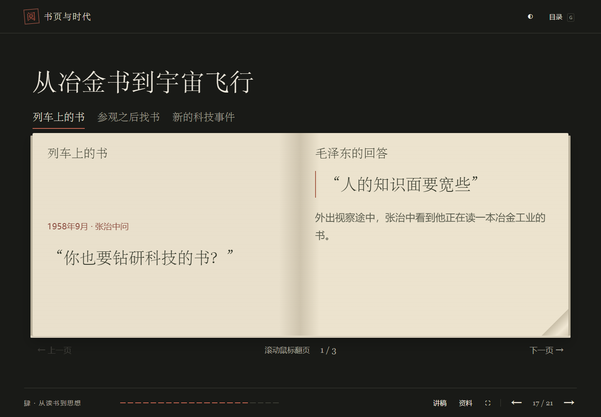
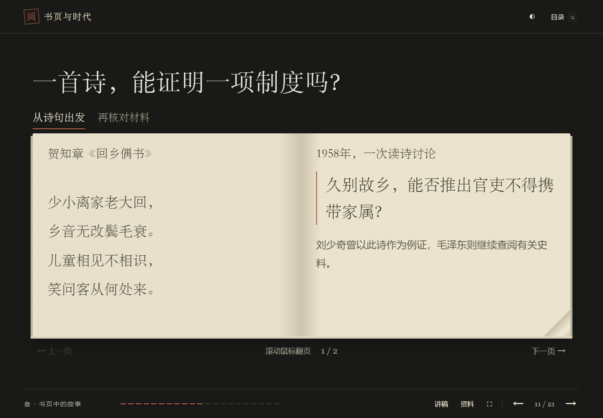

# 读书汇报扩充版审阅说明

本次保留原有17页及其相对顺序，插入4页实质材料，形成19页正文、2页附录。复用原有配色、字号、图片、翻书动画、目录、资料面板。新增书页按材料分配左右内容：诗文与问题、书目与查证结果、教材论点与回应、提问与回答，避免同一事实在左右两边重复。

## 先看这些页面

| 当前页 | 对应原页 | 修改内容 |
| --- | --- | --- |
| 8 | 8 | 分开呈现哲学研读、具体批注、认识与实践；增加《社会学大纲》批注短摘；不提前讲完抗战分析。 |
| 10 | 10 | 画面保留；讲稿用小说第四回“护官符”说明社会关系的阅读视角，明确为本组解释案例。 |
| 11 | 新增 | 《回乡偶书》考据故事，共2个跨页。区分诗句、推论、查证及材料能够支持的判断。 |
| 13 | 12 | 保留四种读法及原翻书内容，标题说明为本组归纳；讲稿减少完整重复，展开对照阅读和讨论。 |
| 14 | 13 | 沿用左图右三步的版式，把原先重复的读书经历改为《论持久战》的问题、条件和变化分析。 |
| 15 | 新增 | 1959—1960年政治经济学读书小组，交代背景、成员、地点及边读边议的方式。 |
| 16 | 新增 | 两个跨页：对经济规律的认识过程，以及劳动者参与管理的权利。 |
| 17 | 新增 | 三个跨页：冶金工业、机床展览后找书、宇宙火箭引发的通俗科学阅读。 |

原P1—P7、P9—P11、P14—P17的投影画面保留。讲稿补充各段之间的衔接，文学阅读与调查研究增加解释，去掉明显的同义复述。P7战火藏书与P12四种方法均保留回顾作用。

## 讲稿与时长

以小组提供的原17页逐页讲稿为底稿，保留原稿的叙述语气，扩充具体案例、论证过程与转场；完整讲稿见 `course/speaker-notes.txt`。备讲在网页讲稿面板中默认折叠，文本版单列在末尾。

主讲正文5764个汉字，另有808字备讲，均不计翻页提示。以下估算为主讲正文加90秒翻页停顿，不含备讲和附录；并非真人排练结果。

| 假设语速 | 估算时长 |
| --- | --- |
| 280字/分钟 | 22.1分钟 |
| 300字/分钟 | 20.7分钟 |
| 330字/分钟 | 19.0分钟 |

材料可支持约20分钟汇报；实际取舍以完整排练为准。语速较快时可选用备讲，不能仅凭页面数量或参考时长保证现场长度。

## 修订页面预览

## 新材料出处

- 古诗考据、三段科学阅读：逄先知《博览群书的革命家》，《人民日报》1986年9月6日第5版，公开转录：https://cn.govopendata.com/renminribao/1986/09/06/5/
- 读书小组及两处讨论：《毛泽东文集》第八卷《读苏联〈政治经济学教科书〉的谈话（节选）》及注释：https://www.shkjdw.gov.cn/c/2014-06-05/491306.shtml
- 《社会学大纲》批注及1939年书信的转引：《李达与毛泽东哲学思想的形成和发展》：https://www.nopss.gov.cn/n/2013/0422/c362279-21235218.html
- 《论持久战》的1938年讲演背景：https://www.12371.cn/2021/05/26/VIDE1621986482011784.shtml
- 讲稿中“护官符”的解释案例：《红楼梦》第四回原文：https://zh.wikisource.org/zh-hans/紅樓夢/第004回

书页将材料短摘、事实整理与本组理解作区分，没有添加未经证实的历史场景或图片。原书版本与页码有待按小组实际用书核对。

## 技术改动

- `slides.js`：内容、讲稿、出处和新增页面。
- `app.js`：为现有翻书页增加诗文、对话、条目与问题展示，讲稿增加默认折叠的备讲区，更新资料面板说明及参考时长标签。原有翻页、动画、图片放大逻辑保留。
- `style.css`：末尾添加新内容的局部样式，保留原样式。
- `index.html`：只更新静态资源缓存版本。
- `tests/course.test.cjs`：检查材料关联、出处、离线图片、新文字卡与原图片页的渲染。

无新增运行依赖，无构建步骤。主网站首页及其他项目文件不在本次修改范围。

## 验证

- JavaScript语法与4项Node内容/渲染检查通过，包含新书页左右内容重复的回归检查。
- Edge浏览器检查21页、32个画面，包括全部18个内部跨页，未发现文字溢出、图片缺失或JavaScript错误。
- 目录、讲稿、资料面板、书页键盘切换以及离线文件打开已检查。
- 深浅主题均检查新增页面。
- 独立HTML离线预览在1440×1000、1366×768和1920×1080三种尺寸下共检查96个画面；全文、图片和翻书正常。全屏、图片放大及滚轮翻书通过。
- 13个保留页面的主体区域与原版截图逐像素一致（页码和进度条不计）。

新增页预览图和完整逐页讲稿随PR提交，便于审阅内容与版式。
